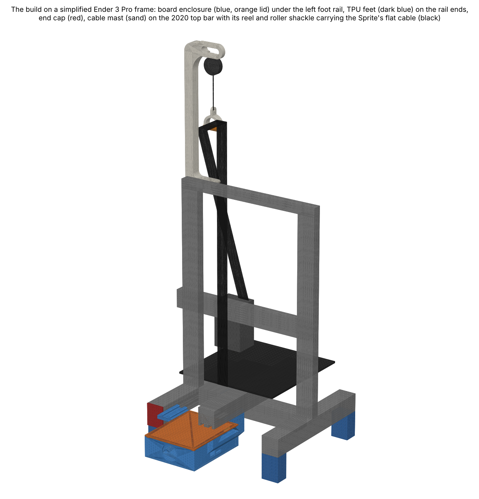

# Ender 3 Pro · SKR 3 EZ · Sprite Pro · Klipper

A complete, working Klipper build for a Creality Ender 3 Pro on a BIGTREETECH
SKR 3 EZ mainboard, with a Creality Sprite Pro direct-drive toolhead, CR Touch,
dual Z motors, a filament runout sensor and MainsailOS on a Raspberry Pi 4.
Everything needed to reproduce it is here: wiring, firmware, configs, the
Mainsail dashboard, and the printed hardware (board enclosure and a cable
mast) as Fusion 360 scripts and ready STLs.

Firmware updates need no SD card: Katapult is flashed to the board once, and
after that a dashboard button rebuilds and flashes Klipper over USB.

*Blue box with orange lid: the board enclosure under the left foot rail. Dark
blue: TPU feet on the rail ends. Red: the rail end cap. Sand: the cable mast on
the top bar, with the retractable reel and the roller shackle carrying the
Sprite's flat cable. The frame itself is drawn as plain boxes; the printed
parts are the real geometry. `docs/renders/render_machine.py` regenerates it.*

## What this build adds over a stock Ender 3 Pro

**Electronics and firmware**
- 32-bit SKR 3 EZ (STM32H723) in place of the 8-bit Creality board, with five plug-in TMC2209 drivers in UART mode: motor currents set in software, silent stealthChop, and one driver per axis including a fifth for the second Z motor.
- Klipper instead of Marlin, hosted on a Raspberry Pi 4 that sits under the stock screen in a printed enclosure ([Thingiverse thing 4586351](https://www.thingiverse.com/thing:4586351)): the motion planning runs on the Pi, the board only steps. Mainsail web interface from any browser on the network, Moonraker API, G-code upload and print start without an SD card.
- Katapult bootloader: Klipper firmware updates over the USB cable from the Pi, started from a dashboard button (FLASH_MCU). No micro-SD shuffle, no brick risk.
- Stock 12864 LCD and beeper kept and working under Klipper.

**Motion and levelling**
- Dual Z: a second lead screw and motor on the right upright, each on its own driver, and `z_tilt` levelling that squares the X gantry to the bed automatically before every print. No more sagging right side.
- CR Touch probe: probed Z homing at the bed centre, a bed mesh, and a screw-assist routine (SCREWS_TILT) that tells you how far to turn each bed knob.
- Adaptive meshing: each print probes only the area it will cover, so a small part takes seconds to mesh and a full bed gets the full grid.
- Input shaper, calibrated with an ADXL345 accelerometer on a Pico over USB: ringing cancelled, acceleration 3900 mm/s² against the stock firmware's 500, with measured motor-skip ceilings for the velocity limit.
- Pressure advance (direct drive), firmware retraction, arc support, exclude-object (cancel one object of a plate mid-print), pause and resume.

**Toolhead**
- Creality Sprite Pro direct-drive extruder: all-metal hotend to 300 °C, dual-gear drive, 0.8 mm nozzle fitted, short filament path, so flexible filaments work. Replaces the Bowden setup and its PTFE-lined 240 °C hotend.
- Hotend heatsink fan under thermal control (runs when the hotend is above 50 °C) instead of always on.

**Filament handling**
- Filament runout sensor at the top of the frame. The print does not stop at the sensor: it runs until the filament still in the tube is used, then pauses, parks and waits with the heaters on. Load new filament, RESUME.
- M600 filament change from the dashboard or from a slicer "pause at layer".
- Nozzle and material buttons: the KAMP purge line sized for 0.2 / 0.4 / 0.6 / 0.8 nozzles, pressure advance on or off for TPU, both remembered across restarts.

**Printed hardware**
- Board enclosure that hangs under the left foot rail on slot keys, no bolts, with a 40 mm fan that runs when motors or heaters are active and whenever the board's MCU is warm, printed feet that lift the frame, a key filler and a rail end cap.
- Cable mast on the 2020 top bar with a retractable badge reel and a printed roller shackle that keeps the Sprite's flat cable off the bed and takes up the slack as Z moves.

**Dashboard**
- One-button PID tuning for hotend and bed, gantry levelling, bed-screw assist, shaper calibration per axis with graph export, CrydTeam speed, acceleration and corner-velocity tests, motor buzz tests, a beep, temperature presets, and FLASH_MCU.
- Temperature readouts for the Pi and the board's MCU; motors release at the end of a print and after 12 hours idle.

## How the special features behave

**Fans.** Three fans on three board headers, each with its own rule:

| Fan | Header | Runs when | Why |
|---|---|---|---|
| Part cooling blower (Sprite "XFan") | FAN0 | At the speed the slicer asks for (`M106`). Off during the first layer if the slicer says so. | Cools the plastic as it is laid down. |
| Hotend heatsink fan (Sprite "Fan") | FAN1 | Whenever the hotend is above 50 °C, until it cools below; full speed. Klipper `heater_fan`. | Stops heat creeping up the heatbreak. On a stock board this fan runs all the time; here the printer is silent when cold. |
| Enclosure fan, 40 mm in the box's front wall | FAN2 | While any motor is enabled or a heater has a target, plus 60 s after that stops; and whenever the board's MCU temperature sensor reads 45 °C or more, until it is back below 40 °C. Full speed. | Keeps the drivers and the MCU cool under load and clears heat that builds up in a closed box even when idle. A small loop in `macros.cfg` checks these conditions every 10 s; Mainsail shows the fan as a slider, but the loop overrides a manual change within 10 s. |

All three run on 24 V through the board's V-FAN jumper. The driver-fan
headers (MFAN) are unused: the enclosure fan covers the drivers.

**Gantry levelling.** Before every print, `Z_TILT_ADJUST` probes a point
above each lead screw and moves the two Z motors independently until the
X gantry is parallel to the bed within 0.025 mm, up to ten rounds. Any
plain `G28` does it too when the gantry has not been levelled since the
motors were last powered. The bed's front-to-back tilt is still the four
knobs; `SCREWS_TILT` probes beside each knob and prints how far to turn it.

**Adaptive mesh.** `START_PRINT` reads the objects' footprint from the
G-code (Moonraker's object processing) and probes only that area, with the
full 5 × 5 density over a full bed. KAMP then parks the head beside the
print area while the nozzle heats and purges a line just in front of it.

**Runout.** The sensor sits at the top of the frame, a tube length before
the extruder. On runout the print carries on until that length of filament
has been extruded, then `M600` pauses, parks at the back and retracts, with
the tail still in the extruder gears. Measure your tube once and set
`tail_mm` in `macros.cfg`. A sensor that sees filament again before then is
treated as a false trigger.

**Remembered settings.** The NOZZLE and PA buttons save their choice in a
small file Klipper keeps beside the config, and a start-up macro re-applies
it, so a restart does not forget which nozzle is fitted or that pressure
advance is off for TPU.

**Firmware updates.** Klipper on the Pi updates through Mainsail's update
manager like any MainsailOS install. When the board's firmware falls behind
it, Mainsail says so, and the FLASH_MCU button rebuilds Klipper for the
board, drops it into the Katapult bootloader, flashes it over the USB cable
and restarts Klipper, all unattended. A bad flash cannot brick the board:
Katapult keeps running and the button can be pressed again.

**Motors and idle.** `END_PRINT` turns the heaters off, presents the bed and
releases all motors. If the printer sits idle for 12 hours with heaters on
or motors held, the heaters go off and the motors release.

**Beeper.** The stock LCD's beeper is wired as a PWM pin named with a
leading underscore so Mainsail does not show it as a slider; the BEEP
button and `M300` drive it.

## Hardware

| Item | Choice |
|---|---|
| Printer | Creality Ender 3 Pro, 24 V |
| Mainboard | BIGTREETECH SKR 3 EZ. Many ship with an **STM32H723** although BTT advertises an H743; read the chip before building firmware. |
| Drivers | 5 × BTT EZ2209 in UART mode: X, Y, Z left, Z right (E1 socket), extruder |
| Bootloader | Katapult, flashed once over DFU; Klipper updates from the Pi over USB |
| Host | Raspberry Pi 4, MainsailOS (Klipper + Moonraker + Mainsail), mounted under the stock screen in a printed enclosure ([Thingiverse thing 4586351](https://www.thingiverse.com/thing:4586351)), one USB cable to the board |
| Toolhead | Creality Sprite Pro direct drive, 0.8 mm nozzle, CR Touch on its bracket |
| Z axis | Two motors, two drivers, `[z_tilt]` on the two lead-screw lines, levelled before every print |
| Filament sensor | Mechanical runout switch at the top of the frame; the print continues until the filament in the tube is used, then pauses |
| Display | Stock Creality 12864 LCD with beeper on EXP1 |
| Accelerometer | ADXL345 on a Raspberry Pi Pico over USB, a second Klipper MCU, for input shaper calibration |

## Build procedure

Each step points at the document with the detail.

0. **Print first.** While the printer still runs stock, print everything in `enclosure/stl` and the three small parts of `cable_mast/out`; the mast itself needs a 310 mm bed. The TPU feet are the hardest print on a Bowden machine, so do them last or borrow a direct-drive printer.
1. **Parts.** `docs/01-bom.md`. The fifth EZ2209 and the long right-Z motor cable are the easy ones to miss.
2. **Board prep.** Jumpers, switches and drivers: `docs/02-wiring.md`, first section.
3. **Pi.** Image MainsailOS and clone this repository on the Pi: `docs/04-mainsailos.md` §1–2. The bench flash needs the Pi running.
4. **Bench flash.** Katapult over DFU, then build Klipper and flash it over USB: `docs/03-firmware-flash.md` §1–4. Note the `/dev/serial/by-id/` path and put it in `config/printer.cfg`. Then finish `docs/04`: config files, Moonraker settings, KAMP, the `gcode_shell_command` extra, the Mainsail backup.
5. **Enclosure.** Print the base, lid, four TPU feet, filler and cap; fit the board and fan; hang the box under the left foot rail: `enclosure/README.md`.
6. **Wiring.** Every harness to its SKR 3 EZ port: `docs/02-wiring.md`, with the pictorial pages `docs/mini-e3-to-skr3ez-cables.pdf`, `docs/cr-touch-repin.pdf` and the printable board diagram `docs/skr3ez-connections.pdf`.
7. **Commissioning.** Cold checks, motor directions, endstops, probe, homing, gantry level, PID, first print: `docs/05-first-power-on.md`.
8. **Tuning.** Input shaper with the Pico accelerometer, then pressure advance and retraction: `docs/06-tuning.md`.
9. **Cable mast.** Mast, shackle, pin and roller for the Sprite's flat cable, two M5 T-nuts into the 2020 top bar, a retractable badge reel through the tip: `cable_mast/README.md`. The one-piece mast is 302 mm long and needs a printer with a bed of at least 310 mm.

## Dashboard

The Mainsail backup sets up these macro groups:

| Group | Buttons |
|---|---|
| SETUP HELPERS | BUZZ_X/Y/Z/Z1/E, BUZZ_ALL, BEEP |
| Calibrate | LEVEL_GANTRY, SCREWS_TILT, BED_LEVEL_CHECK, PID_HOTEND, PID_BED, TEST_SPEED, BENCHMARK, the CrydTeam MAX_VELOCITY / MAX_ACCEL / MAX_SCV tests, ADXL_CHECK, SHAPER_X, SHAPER_Y, SHAPER_PLOT |
| Printing Macros | M600, Z_LOCK |
| MAINTENANCE | FLASH_MCU: rebuilds Klipper and flashes the SKR 3 EZ (and the Pico when plugged in) over USB. Press it when Mainsail reports an MCU protocol mismatch after a Klipper update. |
| NOZZLE / FILAMENT | NOZZLE_0_2 … NOZZLE_0_8 size the KAMP purge line for the nozzle fitted; PA_PLA_PETG and PA_OFF_TPU set pressure advance. Both remembered across restarts. |

Temperature presets: bed off / 30 / 60, nozzle off / 190 / 215 / 230.

## Slicer

Start G-code in Cura: `START_PRINT EXTRUDER_TEMP={material_print_temperature_layer_0} BED_TEMP={material_bed_temperature_layer_0}`
(PrusaSlicer, SuperSlicer and Orca: `START_PRINT BED_TEMP=[first_layer_bed_temperature] EXTRUDER_TEMP=[first_layer_temperature]`),
end G-code `END_PRINT`, Marlin flavor, **relative extrusion on**. START_PRINT
heats the bed, homes, levels the gantry, meshes only the print area, then
heats the nozzle and purges a line. Keep the temperature variables in the
start line: Cura reads them and leaves heating to the macro.

## Repository map

| Path | Content |
|---|---|
| `docs/01-bom.md` | Bill of materials |
| `docs/02-wiring.md` | Jumpers, then every harness → SKR 3 EZ port → Klipper pin |
| `docs/03-firmware-flash.md` | Katapult, Klipper build, flashing from the Pi, FLASH_MCU setup, recovery, SD-card alternative |
| `docs/04-mainsailos.md` | Pi image, config install, Moonraker, KAMP, Mainsail backup |
| `docs/05-first-power-on.md` | Commissioning checklist and common faults |
| `docs/06-tuning.md` | Pico firmware, input shaper, speed tests, pressure advance, retraction |
| `docs/mini-e3-to-skr3ez-cables.html` / `.pdf` | Pictorial cable-by-cable guide. The "from" board pictured is an SKR Mini E3 V3; a stock Creality 4.2.x board uses the same JST-XH plugs on the same harnesses, so the SKR 3 EZ side is what matters |
| `docs/cr-touch-repin.md` / `.html` / `.pdf` | CR Touch 5-pin → SERVOS + Probe headers, pin by pin |
| `docs/skr3ez-connections.html` / `.pdf` | Printable board diagram with every cable, pin and jumper |
| `config/printer.cfg` | Klipper config |
| `config/macros.cfg` | START_PRINT, END_PRINT, M600, LEVEL_GANTRY, deferred runout, nozzle and PA buttons, enclosure fan control, PID helpers, BEEP, TEST_SPEED |
| `config/shell.cfg` | FLASH_MCU and SHAPER_PLOT (gcode_shell_command) |
| `config/adxl.cfg` | Pico accelerometer MCU; included only while it is plugged in |
| `config/KAMP_Settings.cfg` | KAMP Smart Park and Line Purge |
| `config/speed_test.cfg` | CrydTeam speed, acceleration and SCV tests |
| `config/moonraker.conf` | Moonraker: socket path, object processing, update manager |
| `config/backup-mainsail.json` | Mainsail UI: macro groups, hidden macros, temperature presets |
| `tools/flash_skr3.sh` | Rebuild and flash the board (and Pico) from the Pi |
| `tools/shaper_plot.sh` | Render SHAPER_CALIBRATE data to PNGs in the config folder |
| `tools/check_klipper_cfg.py` | Config lint, runs in CI |
| `enclosure/` | Board enclosure, feet, filler, cap: Fusion 360 scripts, STL generators with fit checks, STLs, renders, 3D viewer |
| `cable_mast/` | Cable mast for the 2020 top bar with a retractable reel and a printed roller shackle: parameters, geometry twin, Fusion script, STLs, viewer |
| `.github/workflows/checks.yml` | CI: config lint, Fusion mock runs, fit checks, STLs and viewers current |

## Measured on the reference build

Starting points, not gospel; the docs say how to measure your own.

- Probe repeatability (CR Touch): range 0.015 mm, standard deviation 0.005. `samples_tolerance` 0.03 and `z_tilt retry_tolerance` 0.025 follow from it.
- Input shaper: X MZV 48.2 Hz, Y MZV 36.2 Hz after tensioning the Y belt (27 Hz before). `max_accel` 3900.
- Motors skip at 340 mm/s on X and 440 on Y; `max_velocity` 255.
- Bed crown 0.04 mm along the centreline, handled by the mesh, which is why `z_tilt` uses two points on the lead-screw lines and not a centre point.

## Things that bite

- Motor header coil order is 2B 2A 1A 1B on the SKR 3 EZ, the same as Creality's and the SKR Mini E3's, so stock cables plug straight in. Some dual-Z kit cables are wired straight through with the coil pairs split; the motor grinds until re-crimped A-A-B-B.
- Sprite Pro fan leads: **XFan is the part-cooling blower, Fan is the heatsink fan.**
- STEPPER_BUZZ cannot show an extruder's direction; check it with filament loaded.
- Klipper's `M84` ignores axis letters and releases every motor.
- Moonraker's default socket path is `/tmp/klippy_uds`; MainsailOS puts it under `~/printer_data/comms/`. `moonraker.conf` sets `klippy_uds_address`.
- Mainsail shows a PWM `output_pin` as a slider unless its name starts with an underscore (`_beeper`).
- Klipper refuses SAVE_CONFIG for an option also set in the main file, so `[input_shaper]` is left empty until you calibrate.
- The 4040 foot rails' end cavities are cross shaped, not round, whatever the CAD says; the end cap's pegs are crosses.

## License

GPL-3.0, see `LICENSE`. Pin mappings borrow from Klipper's
`generic-bigtreetech-skr-3.cfg` and `printer-creality-ender3-2018.cfg`
examples (also GPL-3.0). The cable mast is derived from the Kobra Max
harness mast in [Kobra-Max-Improvements](https://github.com/ryanpie86/Kobra-Max-Improvements).
