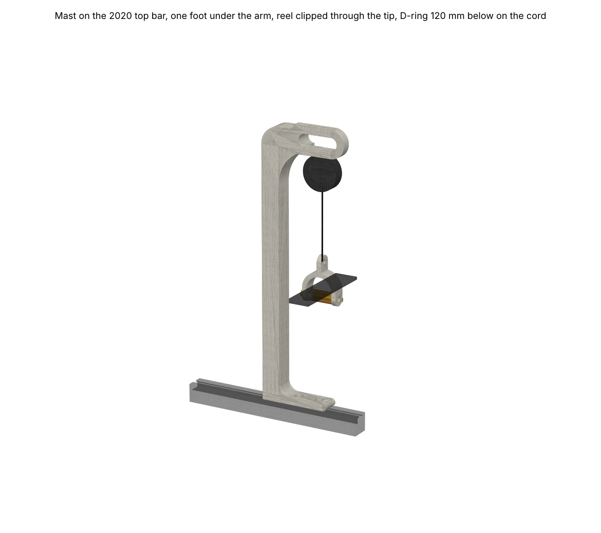

# Sprite harness mast: printed mast, retractable reel, roller shackle

The Sprite's cable sleeve, a flat 25 × 3 mm ribbon, is thrown over the
gantry's top bar. As Z rises the loop goes slack (its apex wants to rise by
about half the Z change, ~118 mm over the Ender's 235 mm); as X moves the
apex shifts sideways. A retractable badge reel on a short mast handles both.

Derived from the Kobra Max mast
([Kobra-Max-Improvements](https://github.com/ryanpie86/Kobra-Max-Improvements),
`parts/cable_mast`), with three changes: 295 mm tall instead of 300, one
foot that reaches out along the bar on the arm's side only, and two M5
T-nuts in the Ender's 2020 top bar instead of four M4.



## Parts

| Qty | Part | File | Orientation |
|---|---|---|---|
| 1 | Mast (foot + column + arm) | `out/mast.stl` | as exported: flat on its back, 20 mm thick, the tip plate on the bed, no support |
| 1 | Shackle | `out/catch_dring.stl` | as exported: flat, a 14 mm slab |
| 1 | Snap pin | `out/catch_pin.stl` | as exported: lying on its flat, slot vertical |
| 1 | Roller | `out/catch_roller.stl` | as exported: standing on end |
| 2 | M5 × 8 screws + M5 T-nuts | | top bar slot |
| 1 | Retractable badge reel with carabiner | | clips through the tip plate's slot |
| 1–2 | 1 inch split rings | | reel cord to the shackle's tab |

PETG for the mast and the pin; anything for the rest. The mast's footprint
flat is 95 × 302 mm, longer than the Ender's own 235 mm bed: print it on a
printer with a bed of at least 310 mm, or have it printed. The three small
parts print anywhere.

## Geometry

| | mm |
|---|---|
| Foot | 75 × 20 × 8 from the column's outer face, semicircular far end, 5.8 × 1.5 key in the 6 mm slot, R12 radius up into the column on the arm's side, 2 × M5 counterbored at 28 and 52 from the column centre |
| Column and arm | 20 × 20 section; column to 295, R40 inside and R20 outside radii, arm 75 reach along the bar in the frame's plane |
| Tip | 30 tall stadium plate, 10 thick and flush with the bed face, blended into the arm with R5; 14 × 44 stadium slot through it across the bar, 8 mm of wall all round; slot centre 285 above the bar, 40 to 70 along it from the column |
| Stiffness | under 10 N at the slot: 0.5 mm down, 2.6 mm sideways, PETG |
| Shackle | one 5 wide × 14 deep band, 29 clear inside for the 25 mm ribbon, legs 8 above the pin axis then a half-ring arch, half-round ends (R7) round the Ø5.8 pin holes, 28 from the pin axis to the arch top, tab with a Ø5 hole |
| Snap pin | Ø5 shank, 45.5 long, Ø10 × 3 head; Ø6.4 barb 0.3 past the far leg with a 1.2 lead-in, 1.2 mm slot over the last 10 mm; 0.4 mm flat along the underside |
| Roller | Ø12 × 28, bore 6, loose on the pin |

## Setting it up

1. Mast onto the top bar left of where the ribbon crosses it, foot and arm
   both to the right, key in the slot, two M5 × 8 into T-nuts.
2. Clip the reel into the slot in the arm's tip plate. Squeeze the pin's
   slotted tip and pull it out of the shackle; lay the ribbon in; push the
   pin back through leg, roller and leg until the barb clicks past the far
   leg. Split ring through the tab to the reel's cord.
3. With Z at 0 the cord is at its longest: check the reel is not at its stop.
   Run Z to the top: the reel takes up ~118 mm. Run X end to end at both
   heights: the ribbon must slide over the roller, not drag the shackle.

## Changing it

Every number is in `mast_params.py`, read by both `cable_mast.py` (STLs,
checks, renders) and the Fusion script, so they cannot drift.
`ARM_DIR = -1` mirrors foot and arm to the left.

```bash
pip install manifold3d trimesh numpy matplotlib
```

```bash
python3 cable_mast/cable_mast.py && python3 cable_mast/build_viewer.py
```

The checks refuse to write STLs if a part is not watertight, the base hits
the bar, a screw lands under the foot radius or past the rounded end, the
pin hits the shackle outside its holes, the ribbon hits the shackle, or
the snap fingers would yield.

## Fusion 360 script

`Fusion/HarnessMast/HarnessMast.py` builds the four bodies (Mast, DRing,
Pin, Roller) from `mast_params.py`. Scripts and Add-Ins → + → Script or
add-in from device → pick the `Fusion/HarnessMast` folder → Run, in a new
design with Z up. Export each body as STL. `Fusion/tests/run_mock.py` runs
it against a stub `adsk` package; CI does the same.

## Interactive view

`out/viewer.html`: assembly, shackle and print layout, orbitable.
