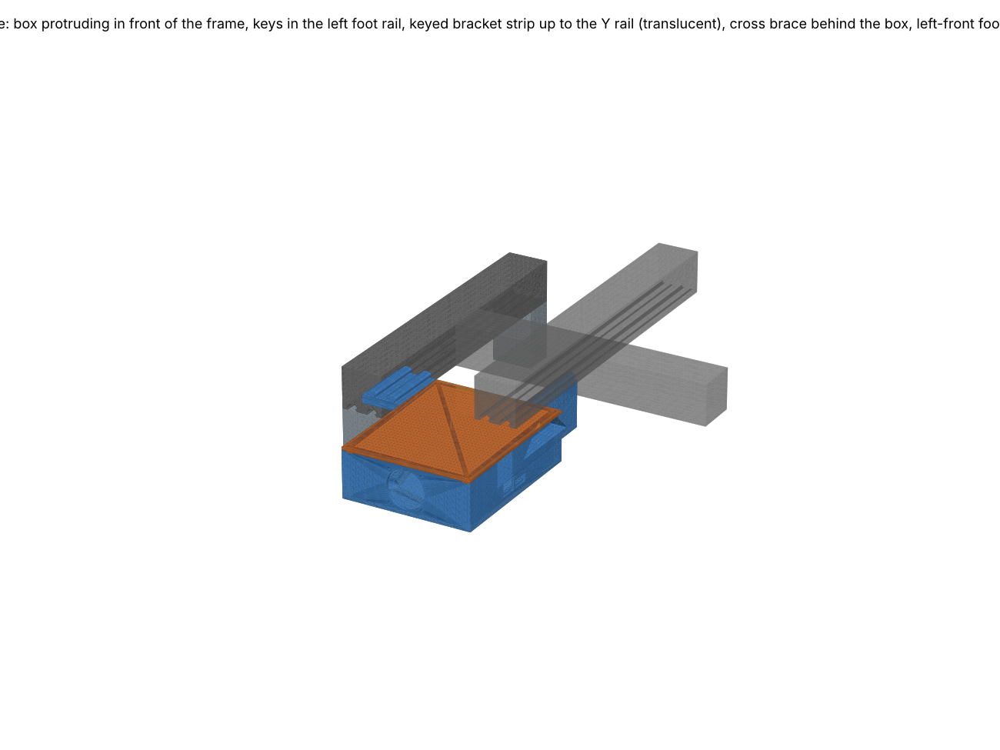
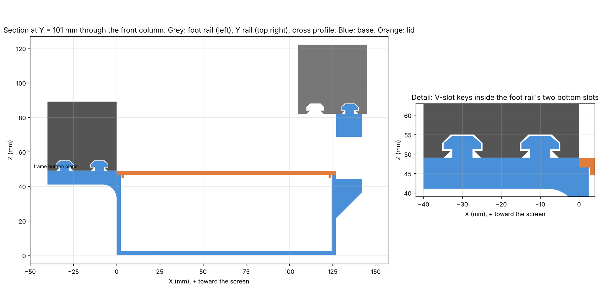
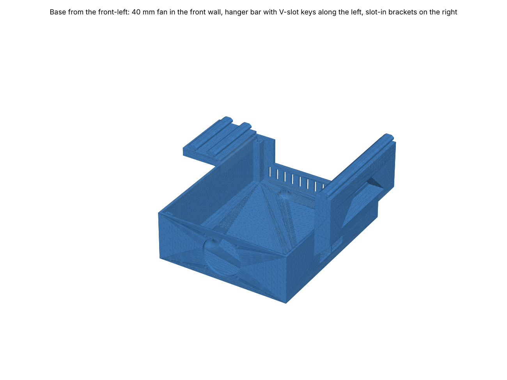
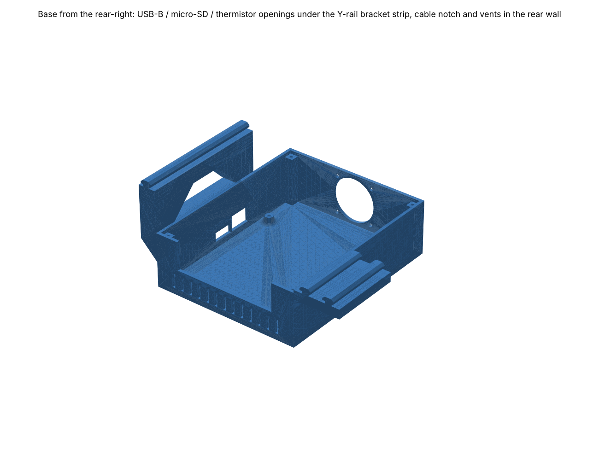
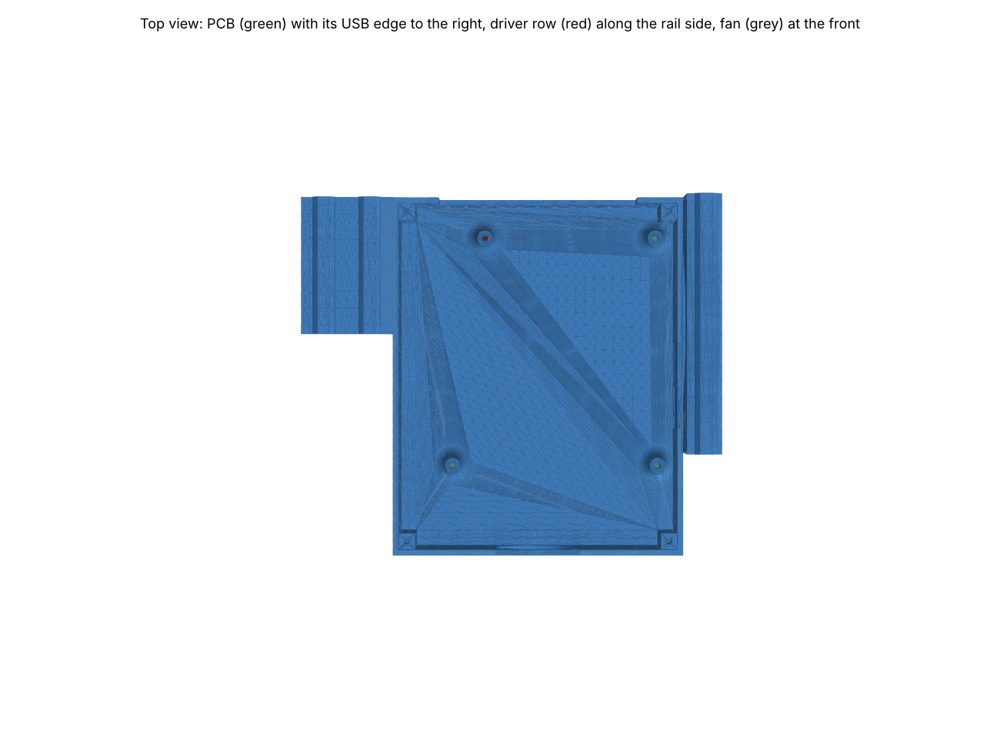
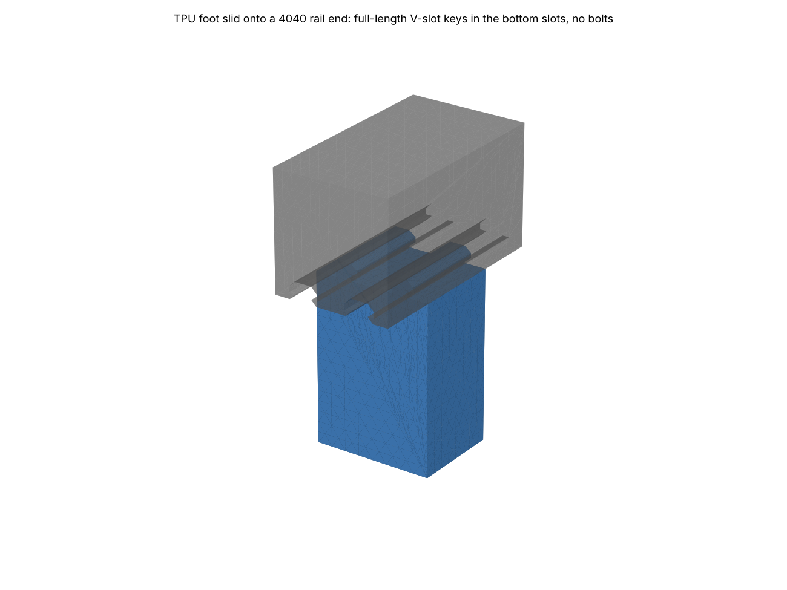

# SKR 3 EZ enclosure for the Ender 3 Pro

A printed box for the SKR 3 EZ that hangs entirely below the frame, with no
bolts. A hanger bar along its left side carries two keys shaped like the rail's
V-slot; they slide into the left foot rail's bottom slots from the rail's end.
A bracket strip on the right wall slides the same key into the Y rail's bottom
slot. Four TPU feet on the rail ends lift the frame so the box clears the
table. The board lies flat with USB-B and micro-SD facing the screen. Cables
enter through one notch in the rear wall; a 40 mm fan in the front wall blows
in; the lid is solid.





| | |
|---|---|
|  |  |
|  |  |

Interactive 3D viewer: open `viewer.html` in a browser.

## Files

| Path | Content |
|---|---|
| `SKR3EZ_Enclosure/SKR3EZ_Enclosure.py` | Fusion 360 script, the single source of every dimension. Builds `Enclosure_Base` and `Enclosure_Lid`. |
| `Foot/Foot.py` | Fusion 360 script, one foot (print 4). Reads the enclosure height from the script above. |
| `Cap/Cap.py` | Fusion 360 script, end cap for the left foot rail: plate, four + shaped pegs (4.2 mm across, 1.5 mm arms) into the rail's corner cavities, skirt over the foot. |
| `KeyFiller/KeyFiller.py` | Fusion 360 script, slot-key filler between the foot and the hanger bar. `FILLER_L` = 34 mm, measured on the reference build. |
| `generate_stl.py`, `generate_foot_stl.py`, `generate_cap_stl.py`, `generate_filler_stl.py` | Geometry twins: build the same parts with `manifold3d`, run the fit checks, write STLs and renders. |
| `stl/*.stl` | Base, lid, foot, cap, key filler, ready to slice. |
| `renders/*.png` | Views of the parts and of the box under the rail. |
| `viewer.html`, `build_viewer.py`, `viewer_template.html` | 3D viewer and its generator. |
| `tests/run_mock.py`, `tests/mock_adsk/` | Runs a Fusion script against a stub `adsk` API. |

## Dimensions

| | mm |
|---|---|
| Base outside, X × Y × height | 127.0 × 156.7 × 46.5; lid 2.5; 49.0 total |
| Walls, floor | 2.5, 2.5 |
| Board standoffs | 4 × Ø7 × 5 tall, Ø2.5 self-tap for M3, on the board's 101.85 × 76.30 pattern |
| Clearance board → walls | 20 left (motor-cable channel), 4 right, 32 front (fan + terminal leads), 10 rear |
| Driver top → lid | 13.4 |
| Hanger bar | 40 wide × 8 thick, full depth; keys at 10 and 30 mm from the rail's inner face |
| Slot key | 5.2 neck, 9.6 chamfered head, 5.6 tall, 0.4 clearance to every slot face (`KEY_CLR`) |
| Y-rail bracket | strip 15 out × 13.4 tall under the rail, key on top, on a full-length flange with a 45° underside |
| Right wall openings | USB-B 19 × 15, micro-SD 18 × 8 |
| Rear wall | notch 103 wide from 22 mm up to the top; 13 intake slots low down |
| Front wall | Ø38 fan opening, four screw holes |
| Lid | solid, lip ring, 4 × counterbored M3 into corner posts |
| Position on the rail | box front 65 mm in front of the rail's front end (`BOX_Y_ON_RAIL`); box ends 33 mm before the cross brace; hanger bar starts 32 mm behind the rail end |
| Feet | 40 × 30 × 57, TPU, same keys full length; 8 mm ground clearance under the box |
| Key filler | 33.7 long (34 gap less 0.3 fit), 40 × 3 base, two keys |

Sources: board outline, hole pattern and connector positions from BTT's
`SKR 3 EZ V1.0-SIZE.pdf`; EZ2209 height measured (25.54 mm above the PCB
underside); frame from Creality's Ender-3 CAD, with the Y rail height
(33 mm) and profile (4040) measured on the printer.

## Printing

| Part | Material | Settings | Orientation | Support |
|---|---|---|---|---|
| Base | PETG or ASA | 0.2 mm, 3 walls, 25 % | Standing on its front (fan) wall, as the STL is written | Tree supports under the hanger bar's front end and under the rear wall |
| Lid | PETG or ASA | 0.2 mm, 3 walls, 25 % | Plate down | None |
| Feet ×4 | TPU 95A | 100 %, slow | On one end, keys vertical, as the STL is written | None |
| Key filler | PETG or ASA | 0.2 mm, 3 walls | Base down | None |
| Cap | PETG or ASA | 0.2 mm, 3 walls | Plate down | None |

Print one foot first as the slot-fit test. A PLA foot at `KEY_CLR` 0.4 slides
on and seats on this frame.

## Assembly

Hardware: `docs/01-bom.md`, enclosure section.

1. Remove the stock rubber feet. Tip the printer on its side.
2. Fit the board to the standoffs, 4 × M3 × 6, USB edge toward the right wall.
3. Fit the fan into the front wall from inside, 4 × M3 × 16 + nuts, blowing in.
4. Offer the box up to the front ends of the left foot rail and the Y rail. Slide the hanger-bar keys into the foot rail's bottom slots and the bracket key into the Y rail's outer bottom slot. Slide back until the box front is 65 mm in front of the frame.
5. Slide a TPU foot onto each of the four rail ends. The left-front one sits in the recess in front of the hanger bar. Stand the printer up.
6. Slide the key filler into the left rail behind the front foot. Press the end cap onto the rail's front end, pegs into the bores, skirt over the foot. Cap, foot, filler, hanger bar: nothing slides.
7. Bring every cable in over the rear notch. Motors down the left channel; heater, bed and PSU leads to the terminals at the front; thermistors with them. Only the USB plug leaves through the right wall.
8. Lid, 4 × M3 × 8.

## Changing the model

Edit the constants at the top of `SKR3EZ_Enclosure.py`, then regenerate.
The generators refuse to write an STL if a fit check fails: parts not
watertight, lid against base, PCB, driver row or fan touching the box, box
touching the rail or the feet.

```bash
pip install manifold3d trimesh numpy matplotlib
```

```bash
python3 enclosure/generate_stl.py
python3 enclosure/generate_foot_stl.py
python3 enclosure/generate_cap_stl.py
python3 enclosure/generate_filler_stl.py
python3 enclosure/build_viewer.py
python3 enclosure/tests/run_mock.py SKR3EZ_Enclosure
python3 enclosure/tests/run_mock.py Foot
```

For another printer: re-measure the foot-to-hanger gap and set `FILLER_L`
in `KeyFiller/KeyFiller.py`; set `Y_RAIL_BOTTOM` and `BOX_Y_ON_RAIL` if the
Y rail or cross brace differ.

## Running the Fusion 360 scripts

1. Fusion 360 → File → New Design.
2. Utilities → Add-Ins → Scripts and Add-Ins (Shift+S) → + → Script or add-in from device → pick the folder `SKR3EZ_Enclosure` (or `Foot`, `Cap`, `KeyFiller`). Keep the folders side by side; the others import the enclosure script.
3. Select the script → Run. Use a fresh design each time.
4. Export: right-click each body under Bodies → Save As Mesh → STL.

The message box reports the built dimensions. If a Fusion run ever disagrees
with an STL from the generators, the STL is right and the script has a bug.

## Historical findings

- The first base print had 12 mm between the board's terminals and the front wall. Too tight for the fan and the lead bends; now 32 (`CLR_FRONT`).
- A third opening in the right wall, at the TFT / CAN / PS-ON / thermistor headers, was removed; nothing leaves the box there.
- The first TPU foot, cut with 0.3 mm clearance and a flare into the V, wedged in the slot. Keys now stop at the throat and cavity with 0.4 clearance.
- Creality's CAD shows a 2040 Y rail on edge; the printer has a 4040 with two bottom slots, 33 mm up, measured on the machine.
- The first end cap had round 3.8 mm pegs, because Creality's STEP draws the 4040's four corner cavities as round bores. On the rail each cavity is a + (cross), which a round peg cannot enter. The pegs are crosses now: 4.5 mm across printed too tight and 4.0 mm loose; 4.2 mm with 1.5 mm arms is the current cut.
- The slot profile was traced from a section of Creality's STEP: 9.6 V at the face, 6.0 throat 1.8 in, 10.4 cavity to 3.8 in, 45° chamfers to the 6.0 roof.
